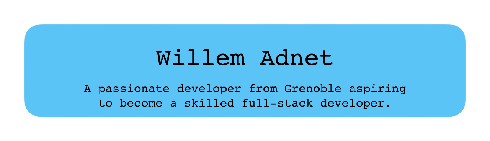

  

  

<h2 align="center">🚀 Languages and Tools</h2>

  
  
  
  
  
  
  
  
  
  
  
  
  
  

<h2 align="center">🛠️ Featured projects</h2>

- **[mxtop](https://github.com/Vlor999/mxtop)**: performance monitoring CLI for Apple Silicon, maintained fork of asitop (`pip install mxtop`)
- **[pr-radar](https://vlor999.github.io/pr-radar/)**: desktop app showing your open GitHub PRs as a tree: stacks, reviews, CI (`brew install --cask vlor999/tap/pr-radar`)
- **[G4AL](https://github.com/Vlor999/G4AL)**: voice-controlled 2D survival game powered by Mistral Voxtral (Mistral Hackathon 2026)
- **[HCI](https://github.com/Vlor999/HCI)**: LLM + RAG that explains a robot's navigation choices

<h2 align="center">⚡️ Where to find me</h2>

  
  
  

<h2 align="center">📊 GitHub Activity</h2>

  

  <picture>
    <source media="(prefers-color-scheme: dark)" srcset="https://github-readme-streak-stats.herokuapp.com/?user=Vlor999&theme=dark&hide_border=true" />
    
  </picture>

