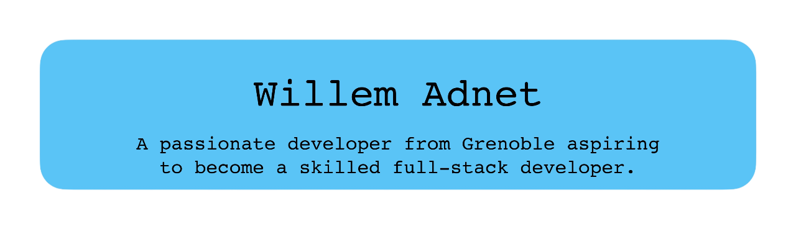

  

# Willem Adnet

Data Scientist at Theodo, Paris. I build tools for Apple silicon and contribute to MLX. I love building personal projects.

Stack: Python, PyTorch, MLX, C/C++, TypeScript, Swift, Rust.

## Featured projects

- [mxtop](https://github.com/Vlor999/mxtop): performance monitoring CLI for Apple silicon, a maintained fork of asitop. `pip install mxtop`
- [pr-radar](https://vlor999.github.io/pr-radar/): desktop app that shows your open GitHub PRs as a tree with stacks, reviews and CI status. `brew install --cask vlor999/tap/pr-radar`
- [chargekeeper](https://vlor999.github.io/chargekeeper/): signed and notarized menu bar app that keeps a MacBook battery at a chosen level. `brew install --cask vlor999/tap/chargekeeper`
- [HCI](https://github.com/Vlor999/HCI): local RAG system that lets a forest robot explain its path choices.
- [G4AL](https://github.com/Vlor999/G4AL): voice-controlled 2D survival game, built at the Mistral Hackathon 2026.

## Open source

Merged in [ml-explore/mlx](https://github.com/ml-explore/mlx), the window functions:

- [#3124](https://github.com/ml-explore/mlx/pull/3124): `hanning`
- [#3135](https://github.com/ml-explore/mlx/pull/3135): `hamming`
- [#3136](https://github.com/ml-explore/mlx/pull/3136): `blackman`
- [#3155](https://github.com/ml-explore/mlx/pull/3155): `bartlett`

## Contact

  
  
  

## GitHub activity

  

